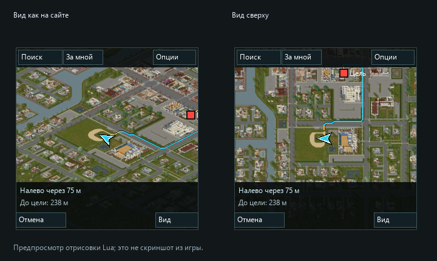

# Knox Navigator

Навигатор для Project Zomboid **Build 42.21**. Карта и поиск работают без браузера и без подключения к сайту во время игры.

**[Скачать установщик для Windows](https://github.com/BlessedsCode/KnoxNavigator/releases/latest/download/KnoxNavigatorSetup.exe)** · [Все файлы релиза](https://github.com/BlessedsCode/KnoxNavigator/releases/latest)



## Установка и первый запуск

Закройте игру, скачайте **KnoxNavigatorSetup.exe**, запустите и нажмите **Установить / обновить**. Установщик сам загрузит карты, проверит файлы и выберет `%USERPROFILE%\Zomboid\mods`. Папку можно изменить кнопкой **Обзор**. Права администратора, Python и ввод команд не требуются.

Скачивается примерно **3,5 ГБ**. На время установки нужно **12 ГБ** свободного места. При обновлении предыдущая папка мода сохраняется рядом в `.KnoxNavigator-backup-*`; сохранения игры установщик не изменяет. Windows может показывать издателя как неизвестного: EXE не подписан цифровым сертификатом.

1. Выйдите в главное меню. Включите **Knox Navigator** в списке модов.
2. Для существующего сохранения включите его также через **Загрузить → выбрать сохранение → Ещё / Моды**. Название кнопок зависит от перевода игры. Перезагрузите сохранение; если мод не появился в списке, перезапустите игру.
3. Сядьте в машину: справа появится окно навигатора. Оно доступно водителю и пассажирам.
4. Нажмите **Поиск**, введите `gift shop`, выберите конкретный магазин и нажмите **Маршрут к выбранному**. Двойной клик по строке тоже строит маршрут.

Для обновления снова запустите установщик. Включение мода в меню игры и в сохранении выполняется вручную после установки.

**Не скачивайте GitHub Source code ZIP для установки:** в исходном репозитории нет изображений карты. Части `KnoxNavigator.zip.001` и `.002` в релизе установщик скачивает автоматически. Для локальной установки EXE также можно положить рядом с готовым `KnoxNavigator.zip` или папкой `KnoxNavigator` из полного пакета.

## Управление

- **Поиск**: английское название объекта, название города или русская категория, например `сувениры`, `заправка`, `аптека`. Русские категории — набор псевдонимов; названия объектов остаются на английском, как в исходном каталоге.
- В каталоге **1 647 объектов**, включая **24 Gift Shop**. Список сортируется по расстоянию **по прямой** от текущего положения, а не по длине автомобильного пути. Для каждого результата видны город и координаты.
- Один клик по результату показывает его на карте. Кнопка **Показать все на карте** подбирает общий масштаб для всех совпадений. Оранжевые маркеры — найденные места.
- **Правый клик** по карте выбирает произвольную цель. Клик по маркеру объекта или друга открывает выбор маршрута.
- **Колёсико** меняет масштаб, **перетаскивание** перемещает карту. **За мной** возвращает слежение за машиной.
- **Отмена** удаляет маршрут. Бирюзовая линия идёт по дорожной сети; оранжевый пунктир показывает последний участок от дороги до входа/координат цели.
- Под картой видны следующий манёвр, расстояние до него и остаток пути. При отклонении маршрут пересчитывается. Голоса нет.
- **Вид** переключает изометрию и вид сверху. Вид сверху — преобразование изображения сайта, поэтому крыши и высокие объекты не являются настоящим ортографическим рендером.

## Настройки

**Опции** в самом навигаторе открывают настройку размера и положения с предпросмотром. Можно перетащить окно за заголовок и нажать **Запомнить текущее положение окна**.

В **Esc → Настройки → Моды → Knox Navigator** доступны все параметры: включение, размер квадрата, положение, вид, ники друзей, список друзей и автоматический пересчёт. Параметры сохраняются штатным механизмом `PZAPI.ModOptions`; отдельная библиотека Mod Options не нужна. Предпросмотр из общих настроек работает после загрузки мира.

## Отдельный сервер

1. Скопируйте папку `KnoxNavigator` в папку модов сервера и на компьютеры всех четырёх игроков.
2. В конфигурации сервера добавьте `KnoxNavigator` в существующий список `Mods=`, сохраняя остальные значения. Пример: `Mods=OtherMod;KnoxNavigator`.
3. Перезапустите сервер. Это локальная установка: у мода пока **нет Workshop ID**, поэтому добавлять выдуманное число в `WorkshopItems=` нельзя.
4. При пустом поле **Ники друзей** видны все онлайн-игроки сервера — для вашего сервера на четверых это три друга. Можно ограничить отображение точными никами через запятую.

Координаты берутся с сервера примерно раз в две секунды, независимо от расстояния между игроками. Устаревшие маркеры исчезают через восемь секунд. Клик по другу позволяет построить маршрут к нему; при перемещении друга цель и путь обновляются. Настройка ников фильтрует отображение на клиенте; сервер передаёт позиции всех онлайн-игроков участникам, использующим мод. В одиночке сетевой обмен не выполняется.

## Что проверено и ограничения

Проверены синтаксис **Lua 5.1**, поиск всех 24 Gift Shop и сортировка, русские псевдонимы, маршруты между Riverside, West Point, Muldraugh, Rosewood и Louisville, сохранение поворотов и отказ при несвязанных дорогах. Проверены обработчики окна в тестовом окружении: показ/скрытие при посадке, преобразование координат обоих видов, выбор конкретного результата, настройки, три маркера друзей, удаление устаревших позиций и отмена пути.

Версия **0.2.0** исправляет ошибки, выявленные при запуске в игре: значение `nil` при выходе из машины, невосстановленную вложенную маску рисования (из-за неё скрывались кнопки и подписи) и кодировку кириллицы в Lua-строках. Добавлен подробный слой карты уровня 17: в четыре раза больше пикселей по каждой стороне, чем у первого слоя уровня 15. Настройки, обработчики входа/выхода из машины, поиск и расчёт маршрута также проверяются на Kahlua из установленного `projectzomboid.jar`, с тем же чтением исходника через UTF-8 Reader. Нативные оконные элементы в автоматической проверке заменяются тестовыми объектами; полноценно повторно проверить графический интерфейс в игре и игру с четырьмя участниками ещё нужно. `preview.png` — предпросмотр реальных Lua-команд отрисовки через тестовый рендерер, а не скриншот из игры.

Изображения и POI — снимок **B42.20.2-r1**, дорожная сеть получена из установленной **B42.21**. Возможны расхождения на изменённых участках. Карта показывает наземный слой, без переключения этажей. Локальные изображения имеют фиксированную детализацию: увеличение до масштаба отдельных комнат на сайте качественнее. Мод рассчитан на стандартную карту, а не на дополнительные города. Навигатор не учитывает зомби, машины, заборы, завалы и временные препятствия. Он использует растровую дорожную сеть с шагом четыре клетки; последний подход к объекту выделен отдельно. Локальный интерфейс предназначен для одного игрока за компьютером; split-screen не реализован.

## Источники и сборка

- Изображения и каталог: [Project Zomboid Map](https://projectzomboidmap.com/), набор `maps/b42.20.2-r1` на `tiles.projectzomboidmap.com`.
- Исходный сайт указывает [pzmap2dzi](https://github.com/cff29546/pzmap2dzi) как генератор изображений. Этот проект не связан с авторами сайта и The Indie Stone. Сторонние изображения и данные не объявляются собственными и не перелицензируются этим модом.
- Дороги: `media/maps/Muldraugh, KY/worldmap.xml` и штатные `streets.xml` установленной игры.
- `tools/build_data.py`: создаёт каталог TSV, дорожную сеть, локальные изображения и обзорные текстуры. Использует Pillow; сетевые запросы ограничены четырьмя рабочими потоками и кешируются. Исходный JS сайта сохранён в `site-reference.js`; код сайта не исполняется.
- `tools/test_mod.py`: проверки алгоритмов и интерфейсных обработчиков в Lua 5.1 через Lupa. `tools/test-report.json` содержит измерения пяти маршрутов.
- `tools/build_detail.py`: загружает подробные изображения уровня 17 и создаёт вид сверху. Обзорный слой используется только при большом отдалении.
- `tools/encode_lua_text.py`: кодирует не-ASCII символы в строках Lua через числовые UTF-8 escape-последовательности, чтобы компилятор игры не искажал кириллицу.
- `tools/test_kahlua.py`: проверяет загрузку каталога, кириллицу, поиск, настройки, выход/вход в машину и маршрут непосредственно на движке Kahlua установленной игры. Для запуска нужен JPype1 и игровые файлы.

Изображения и игровые данные сохраняют права своих авторов. См. [CREDITS.txt](KnoxNavigator/common/CREDITS.txt). В Steam Workshop этот пакет не загружался.

## Сборка установщика и релиза

На Windows с .NET Framework 4.x:

```powershell
./installer/build.ps1 -Repository BlessedsCode/KnoxNavigator
python tools/test_installer.py
python tools/prepare_release.py --repository BlessedsCode/KnoxNavigator --tag v0.2.4
```

Последняя команда использует готовый полный `KnoxNavigator.zip`, создаёт части менее 2 ГиБ, `manifest.json` и контрольные суммы в `dist/release`. EXE находится в `dist/KnoxNavigatorSetup.exe`. В релиз загружаются EXE и все файлы из `dist/release`; имя тега должно совпадать с `--tag`. Сам установщик всегда получает манифест последнего опубликованного релиза.
